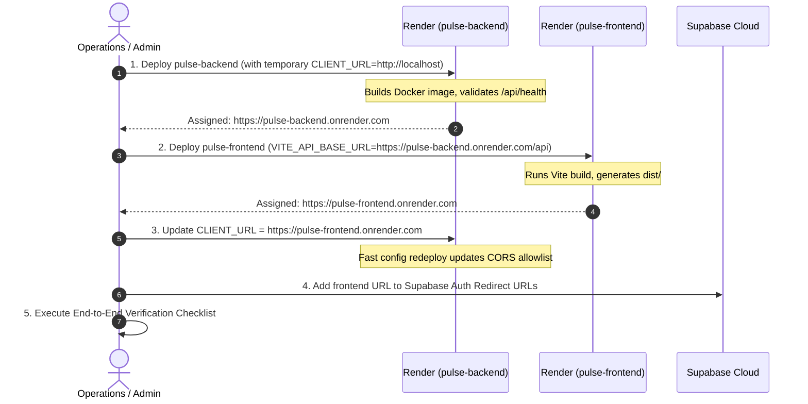

# Pulse — Production Render Deployment Guide

This guide details the preparation, configuration, deployment sequence, security protocols, and operational management for deploying **Pulse** to **Render** ([https://render.com](https://render.com)).

---

## 1. Architectural Overview

Pulse is deployed on Render as two decoupled, high-performance services connected to an existing managed **Supabase Cloud** instance:

```
                          ┌────────────────────────────────┐
                          │   Global Users / Browsers      │
                          └──────────────┬─────────────────┘
                                         │
                 ┌───────────────────────┴───────────────────────┐
                 │ HTTPS                                         │ HTTPS /api/*
                 ▼                                               ▼
   ┌───────────────────────────┐                   ┌───────────────────────────┐
   │    pulse-frontend         │                   │     pulse-backend         │
   │  (Render Static Site)     │                   │  (Render Web Service)     │
   │  • Global CDN             │                   │  • Docker (Node 20)       │
   │  • React 18 / Vite 6 SPA  │                   │  • Plan: Free ($0/mo)     │
   │  • Client-side routing    │                   │  • Single Instance (x1)   │
   │  • Service Worker (/sw.js)│                   │  • RSS Ingestion Cron     │
   │  • Cold-start retry logic │                   │  • Hourly Briefing Cron   │
   └───────────────────────────┘                   └─────────────┬─────────────┘
                                                                 │
                                                       HTTPS     │ (Service Role / Anon)
                                                                 ▼
                                                   ┌───────────────────────────┐
                                                   │      Supabase Cloud       │
                                                   │  • PostgreSQL 15 + RLS    │
                                                   │  • Auth & User Storage    │
                                                   │  • Editorial Repository   │
                                                   └───────────────────────────┘
```

### Key Infrastructure Principles (100% Free Tier — $0/month)
1. **Free Backend Web Service (`plan: free`)**: Pulse backend runs on Render's free tier. The container spins down after 15 minutes of inactivity to conserve resources. When new web traffic arrives, the frontend automatically handles the 30-50s spin-up time with gentle cold-start status notices and exponential backoff retries.
2. **Single Backend Instance (`numInstances: 1`)**: Background tasks execute directly in the Node.js process. Running multiple instances would lead to duplicate RSS fetches and duplicate briefings. Single instance is strictly enforced.
3. **High-Performance Static CDN for Frontend**: The React/Vite application compiles to static HTML/JS/CSS, deployed onto Render's global CDN at $0/month with automated SPA rewrite rules and optimized caching headers.
4. **Cloud-First Storage with Local Backup Safety**: `PULSE_STORAGE_MODE=cloud` connects the backend to Supabase Cloud PostgreSQL. Local JSON files and backups are never committed to Git.

---

## 2. Render Blueprint Specification (`render.yaml`)

Pulse includes a production-ready Blueprint specification at the repository root ([render.yaml](file:///d:/Aashrith/Webs/Plause/render.yaml)).

```yaml
# ==============================================================================
# PULSE — RENDER BLUEPRINT SPECIFICATION (render.yaml)
# ==============================================================================

services:
  # ----------------------------------------------------------------------------
  # 1. PULSE BACKEND WEB SERVICE
  # ----------------------------------------------------------------------------
  - type: web
    name: pulse-backend
    runtime: docker
    dockerfilePath: ./server/Dockerfile
    dockerContext: ./server
    plan: free # 100% Free Web Service ($0/month)
    region: oregon # Match closely with your Supabase region
    numInstances: 1 # Exactly 1 instance to prevent duplicate in-process cron jobs
    healthCheckPath: /api/health
    envVars:
      - key: PORT
        value: 3001
      - key: NODE_ENV
        value: production
      - key: PULSE_STORAGE_MODE
        value: cloud
      - key: CLIENT_URL
        sync: false # Set to frontend URL (e.g., https://pulse-frontend.onrender.com)
      - key: SUPABASE_URL
        sync: false # e.g., https://<project-ref>.supabase.co
      - key: SUPABASE_ANON_KEY
        sync: false
      - key: SUPABASE_SERVICE_ROLE_KEY
        sync: false # Confidential: server-side elevated access
      - key: ADMIN_API_KEY
        sync: false # 256-bit secret protecting /api/admin/*
      - key: AI_PRIMARY_PROVIDER
        value: fallback
      - key: AI_SECONDARY_PROVIDER
        value: fallback
      - key: OPENAI_API_KEY
        sync: false # Optional
      - key: ANTHROPIC_API_KEY
        sync: false # Optional
      - key: XAI_API_KEY
        sync: false # Optional
      - key: VAPID_PUBLIC_KEY
        sync: false
      - key: VAPID_PRIVATE_KEY
        sync: false
      - key: VAPID_SUBJECT
        value: mailto:admin@pulse.news
      - key: ENABLE_BACKGROUND_SCHEDULER
        value: "true"

  # ----------------------------------------------------------------------------
  # 2. PULSE FRONTEND STATIC SITE
  # ----------------------------------------------------------------------------
  - type: web
    runtime: static
    name: pulse-frontend
    rootDir: client
    buildCommand: npm ci && npm run build
    staticPublishPath: dist
    routes:
      # SPA fallback rewrite: ensures deep client routes resolve to index.html
      - type: rewrite
        source: /*
        destination: /index.html
    headers:
      - path: /*
        name: X-Frame-Options
        value: SAMEORIGIN
      - path: /*
        name: X-Content-Type-Options
        value: nosniff
      - path: /*
        name: Referrer-Policy
        value: strict-origin-when-cross-origin
      # Service worker must never be cached so updates take effect immediately
      - path: /sw.js
        name: Cache-Control
        value: no-cache, no-store, must-revalidate
      # Immutable content-hashed JS/CSS assets
      - path: /assets/*
        name: Cache-Control
        value: public, max-age=31536000, immutable
    envVars:
      - key: VITE_API_BASE_URL
        sync: false # e.g., https://pulse-backend.onrender.com/api
```

---

## 3. Environment Variable Checklist

All secret variables are marked `sync: false` in `render.yaml` so that sensitive tokens are never committed to version control. They must be entered into the Render Dashboard.

### A. Backend Web Service (`pulse-backend`)

| Variable Name | Required | Default / Value | Secret? | Purpose & Guidance |
| :--- | :---: | :--- | :---: | :--- |
| `PORT` | **Yes** | `3001` | No | Internal port bound by Express (`0.0.0.0:3001`). Render routes external HTTPS traffic to this port automatically. |
| `NODE_ENV` | **Yes** | `production` | No | Enables production optimizations in Express and runtime dependencies. |
| `PULSE_STORAGE_MODE` | **Yes** | `cloud` | No | Enforces `SupabaseNewsRepository` for cloud persistence. |
| `CLIENT_URL` | **Yes** | `https://<frontend-subdomain>.onrender.com` | No | Comma-separated list of allowed CORS origins. Set to your frontend Render URL and any custom domains. |
| `SUPABASE_URL` | **Yes** | `https://<project-ref>.supabase.co` | No | URL of your Supabase Cloud project. |
| `SUPABASE_ANON_KEY` | **Yes** | `<supabase-anon-public-key>` | **Yes** | Supabase client anon public key used for client auth context. |
| `SUPABASE_SERVICE_ROLE_KEY` | **Yes** | `<supabase-service-role-key>` | **Yes** | **Confidential.** Bypasses RLS for backend ingestion and hourly briefing compilation. Never expose to client. |
| `ADMIN_API_KEY` | **Yes** | `<high-entropy-random-secret>` | **Yes** | Protects `/api/admin/*` administrative routes and manual ingestion triggers. |
| `AI_PRIMARY_PROVIDER` | **Yes** | `fallback` | No | Keep as `fallback` until paid providers are authorized. Pulse operates with zero external API costs. |
| `AI_SECONDARY_PROVIDER` | **Yes** | `fallback` | No | Secondary AI failover provider. |
| `ENABLE_BACKGROUND_SCHEDULER` | **Yes** | `true` | No | Initializes `taskScheduler` for RSS feeds (`*/30`), briefings (`0 * * * *`), and notifications (`*/15`). |
| `OPENAI_API_KEY` | No | *(Leave empty)* | **Yes** | Optional OpenAI API key (for GPT-4o-mini). |
| `ANTHROPIC_API_KEY` | No | *(Leave empty)* | **Yes** | Optional Anthropic API key (for Claude 3.5 Haiku). |
| `XAI_API_KEY` | No | *(Leave empty)* | **Yes** | Optional xAI API key (for Grok-2). |
| `VAPID_PUBLIC_KEY` | No | *(Leave empty or configure)* | No | Web Push VAPID public key. |
| `VAPID_PRIVATE_KEY` | No | *(Leave empty or configure)* | **Yes** | Web Push VAPID private signing key. |
| `VAPID_SUBJECT` | No | `mailto:admin@pulse.news` | No | Contact email for Web Push notifications. |

### B. Frontend Static Site (`pulse-frontend`)

| Variable Name | Required | Example Value | Secret? | Purpose & Guidance |
| :--- | :---: | :--- | :---: | :--- |
| `VITE_API_BASE_URL` | **Yes** | `https://pulse-backend.onrender.com/api` | No | Full URL pointing to the backend API. **Must be provided at build time** as Vite compiles this value directly into the static bundle. |

> [!WARNING]
> **Client Secret Isolation:**
> Under no circumstances should `SUPABASE_SERVICE_ROLE_KEY`, `ADMIN_API_KEY`, or AI provider keys (`OPENAI_API_KEY`, `ANTHROPIC_API_KEY`, `XAI_API_KEY`) be provided to `pulse-frontend`. The frontend only needs `VITE_API_BASE_URL`.

---

## 4. Build and Runtime Configurations

### Backend Service Specification
- **Service Name**: `pulse-backend`
- **Environment**: `Docker`
- **Context Directory**: `./server`
- **Dockerfile Path**: `./server/Dockerfile`
- **Instance Plan**: `Free` ($0/mo) — 100% free tier web service
- **Instance Count**: `1`
- **Health Check Path**: `/api/health`
- **Host Binding**: `0.0.0.0`
- **Port**: `3001` (configured via `PORT` environment variable)

#### Multi-Stage Dockerfile Execution
1. **Builder Stage (`node:20-alpine`)**:
   - Executes `npm ci`
   - Compiles TypeScript using `npm run build` (`tsc`)
   - Emits optimized ES Module JavaScript to `/app/dist`
2. **Runner Stage (`node:20-alpine`)**:
   - Installs `dumb-init` and `curl`
   - Executes `npm ci --omit=dev` for lean runtime dependencies
   - Copies compiled `/app/dist` and fallback database `/app/data`
   - Drops privileges to non-root `node` user (`USER node`)
   - Configures native container `HEALTHCHECK` against `http://localhost:${PORT:-3001}/api/health`
   - Uses `dumb-init` as `ENTRYPOINT` to ensure proper signal forwarding (`SIGTERM`/`SIGINT`) for graceful shutdown

### Frontend Static Site Specification
- **Service Name**: `pulse-frontend`
- **Environment**: `Static Site`
- **Root Directory**: `client`
- **Build Command**: `npm ci && npm run build`
- **Publish Directory**: `dist`
- **SPA Routing Rule**:
  - Source: `/*`
  - Destination: `/index.html`
  - Action: `Rewrite`
- **Header Rules**:
  - `/sw.js` -> `Cache-Control: no-cache, no-store, must-revalidate`
  - `/assets/*` -> `Cache-Control: public, max-age=31536000, immutable`
  - `/*` -> `X-Frame-Options: SAMEORIGIN`, `X-Content-Type-Options: nosniff`, `Referrer-Policy: strict-origin-when-cross-origin`

---

## 5. Deployment Sequence (Handling the Circular URL Dependency)

The frontend and backend have a circular dependency during initial setup:
- The **frontend** build embeds `VITE_API_BASE_URL` (requires the backend's URL).
- The **backend** CORS policy validates requests against `CLIENT_URL` (requires the frontend's URL).

Follow this step-by-step sequence to deploy cleanly without connection errors:



### Detailed Deployment Steps

#### Step 1: Deploy Backend Web Service First
1. In Render Dashboard, click **New +** -> **Blueprint** (or connect via `render.yaml`).
2. Alternatively, click **New +** -> **Web Service**:
   - Name: `pulse-backend`
   - Source: Connect your Git repository
   - Environment: `Docker`
   - Docker Context: `./server`
   - Dockerfile Path: `./server/Dockerfile`
   - Plan: `Starter`
   - Health Check Path: `/api/health`
3. Enter the environment variables from the Backend table above.
   - For `CLIENT_URL`, set temporarily to `http://localhost:5173,http://localhost:3000`.
4. Click **Create Web Service**.
5. Wait for the build and health check to pass. Copy the assigned URL (e.g., `https://pulse-backend.onrender.com`).
6. Test in browser: `https://pulse-backend.onrender.com/api/health` should return `{"status":"healthy","cloudConnected":true,...}`.

#### Step 2: Deploy Frontend Static Site
1. In Render Dashboard, click **New +** -> **Static Site**:
   - Name: `pulse-frontend`
   - Root Directory: `client`
   - Build Command: `npm ci && npm run build`
   - Publish Directory: `dist`
2. Under **Environment Variables**, add:
   - `VITE_API_BASE_URL`: `https://pulse-backend.onrender.com/api`
3. Under **Redirects/Rewrites**, ensure the SPA rewrite rule is present:
   - Type: `Rewrite`
   - Source: `/*`
   - Destination: `/index.html`
4. Click **Create Static Site**.
5. Wait for the build to finish. Copy the assigned URL (e.g., `https://pulse-frontend.onrender.com`).

#### Step 3: Close the CORS Loop on Backend
1. Return to the **pulse-backend** settings on Render.
2. In the **Environment** tab, update `CLIENT_URL`:
   - `https://pulse-frontend.onrender.com` (and your custom domain if applicable).
3. Save changes. Render will perform a quick zero-downtime rolling restart.

#### Step 4: Configure Supabase Cloud Authentication
1. Open your [Supabase Dashboard](https://supabase.com/dashboard).
2. Navigate to **Authentication** -> **URL Configuration**.
3. In **Site URL**, set:
   - `https://pulse-frontend.onrender.com`
4. In **Redirect URLs**, add:
   - `https://pulse-frontend.onrender.com/**`
   - `https://pulse-frontend.onrender.com/`
5. Save changes. This ensures email confirmations, password resets, and session tokens redirect correctly.

---

## 6. Pre-Deployment Security Checklist

Before approving live deployment, verify every security item:

- [ ] **No Hardcoded Secrets**: Scan repository to ensure no API keys, connection strings, or service keys are in tracked files.
- [ ] **Secret Isolation**: Confirm `SUPABASE_SERVICE_ROLE_KEY` and `ADMIN_API_KEY` are only configured in `pulse-backend`, never in `pulse-frontend`.
- [ ] **RLS Enforcement**: Supabase tables have Row Level Security enabled. Unauthenticated users can read published editorial data (`stories`, `articles`, `hourly_briefings`) but cannot access private user tables (`user_saved_stories`, `user_vocabulary`, `user_preferences`, `user_reading_history`).
- [ ] **CORS Restriction**: Backend `CLIENT_URL` restricts origins to only the verified frontend domain; wildcard `*` is not permitted in production.
- [ ] **Container Security**: Backend runs as unprivileged user `node` (`USER node`), not `root`.
- [ ] **Rate Limiting**: Backend rate limiters (`generalLimiter`, `authLimiter`, `aiLimiter`, `feedbackLimiter`) are active in production.
- [ ] **Security Headers**: Both Nginx/Render headers and Express Helmet/middleware enforce `X-Frame-Options: SAMEORIGIN`, `X-Content-Type-Options: nosniff`, and `Referrer-Policy: strict-origin-when-cross-origin`.
- [ ] **Zero Cost AI Profile**: `AI_PRIMARY_PROVIDER=fallback` and `AI_SECONDARY_PROVIDER=fallback` ensure no external billing charges are incurred.

---

## 7. Post-Deployment Verification Steps

Perform the following smoke tests against the live deployment:

### 1. Health & Database Connectivity
```bash
curl -i https://pulse-backend.onrender.com/api/health
```
**Expected Response**:
- HTTP `200 OK`
- JSON payload:
  ```json
  {
    "status": "healthy",
    "storageMode": "cloud",
    "cloudConnected": true,
    "diagnostics": {
      "storiesCount": 25,
      "articlesCount": 25,
      "briefingsCount": 14,
      ...
    },
    "aiIntegrations": {
      "primaryProvider": "fallback",
      "availableProviders": ["fallback"]
    },
    "scheduler": {
      "running": true
    }
  }
  ```

### 2. Frontend SPA Routing & Asset Loading
1. Open `https://pulse-frontend.onrender.com` in a clean incognito window.
2. Confirm the Pulse homepage renders cleanly with editorial stories and state selectors.
3. Refresh deep routes directly in the browser address bar:
   - `https://pulse-frontend.onrender.com/vocabulary`
   - `https://pulse-frontend.onrender.com/admin`
   - Verify neither produces a 404 error (verifying SPA rewrite rule).
4. Open browser DevTools Network tab:
   - Confirm `/sw.js` returns `Cache-Control: no-cache, no-store, must-revalidate`.
   - Confirm JS/CSS chunks return `Cache-Control: public, max-age=31536000, immutable`.

### 3. User Authentication & Cloud Persistence
1. Register a test user or sign in with an existing user.
2. Bookmark a story -> Verify it shows under "Saved".
3. Save a vocabulary term -> Verify it persists under `/vocabulary`.
4. Refresh the page -> Verify state persists from Supabase.
5. Sign out -> Verify user state clears cleanly.

### 4. Admin Security
1. Navigate to `https://pulse-frontend.onrender.com/admin`.
2. Attempt an action without providing the `ADMIN_API_KEY` -> Verify request is rejected with `401 Unauthorized`.
3. Provide the configured `ADMIN_API_KEY` -> Verify access is granted.

---

## 8. Rollback & Disaster Recovery Procedures

If an operational issue arises during or after deployment:

### Scenario A: Deployment Failure / Bad Release (Render Level)
1. In Render Dashboard, navigate to the affected service (`pulse-backend` or `pulse-frontend`).
2. Go to the **Events** tab.
3. Locate the previous successful deployment.
4. Click the three dots (`...`) -> **Rollback to this deploy**.
5. Render immediately restores the previous Docker image or static build without re-compiling.

### Scenario B: Cloud Database Outage / Supabase Connectivity Failure (Safe Degraded Mode)

If Supabase Cloud experiences an outage or temporary network unreachability:

> [!CRITICAL]
> **Do NOT toggle `PULSE_STORAGE_MODE=local` during a cloud outage.**
> Switching to local storage in production causes split-brain data corruption:
> 1. **Stale Data Presentation**: The container would read from an outdated snapshot frozen prior to cloud migration.
> 2. **Ephemeral Data Loss**: User bookmarks, reading history, preferences, and vocabulary reviews written to container disk will be permanently wiped on the next deploy or container restart.
> 3. **False Confirmation**: Users are misled into believing their personal actions were safely committed to their accounts.

#### Safe Degraded Mode Protocol:
1. **Preserve Cloud Mode (`PULSE_STORAGE_MODE=cloud`)**:
   - Keep the backend running in cloud mode. Never switch production to local JSON.
2. **Automated Health Status**:
   - `/api/health` detects that `repo.ping()` returns `false` and reports:
     `{ "status": "degraded", "storageMode": "cloud", "cloudConnected": false }`.
   - Render does not terminate the container because the route returns HTTP 200 with degraded health status, keeping the API process alive.
3. **Explicit Error Reporting for User Actions**:
   - Any write requests (`POST /api/saved-stories`, `POST /api/vocabulary`, `POST /api/auth/*`) explicitly fail with descriptive HTTP 503 / 500 error responses (`{ "error": "Cloud storage temporarily unavailable. Please retry shortly." }`).
   - The UI surfaces clear notifications informing the user that the action cannot be saved right now.
   - Users are never misled into believing an offline action was saved.
4. **Reconnection & Recovery**:
   - Once Supabase Cloud resolves its outage, `repo.ping()` immediately returns `true`.
   - `/api/health` automatically returns `status: "healthy", cloudConnected: true`.
   - The scheduled background ingestion worker (`node-cron`) automatically resumes on its next 30-minute interval and syncs incoming RSS stories to Supabase.
   - No manual data reconciliation or database repair is required because no divergent local writes took place.
5. **Disaster Recovery Asset (`server/data/pulse.db.json`)**:
   - The verified cold snapshot (`server/data/pulse.db.json`, 13.3 MB) is preserved strictly on local development/operational storage as a catastrophe disaster-recovery asset (e.g. for complete database reconstruction via `migrateLocalToSupabase.ts` in case of total data loss).

---

## 9. Compatibility Findings & Mitigations

During deployment inspection and local production testing, the following items were identified and addressed:

1. **Host Binding (`0.0.0.0`)**:
   - *Finding*: Default Express server bound to localhost (`127.0.0.1`), which would prevent external port forwarding in Docker and Render.
   - *Mitigation*: Updated `server/src/index.ts` to explicitly bind to `0.0.0.0` and read `process.env.PORT`.
2. **Dynamic Base URL Sanitization**:
   - *Finding*: When Render environment variables inject hostnames (e.g., via service references), URLs might lack the protocol or `/api` prefix.
   - *Mitigation*: Enhanced `client/src/utils/api.ts` to automatically prepend `https://` if a bare hostname is provided and ensure `/api` is normalized.
3. **Background Scheduler Singleton & Distributed Locking**:
   - *Finding*: Scaling backend horizontally would execute duplicate RSS ingestion cycles and duplicate Hourly Pulse summaries.
   - *Mitigation*: Explicitly set `numInstances: 1` in `render.yaml` and verified idempotent upserts (`onConflict: 'id'`) for briefings. Scaling beyond 1 instance will require Redis Redlock or PostgreSQL advisory locks.
4. **Service Worker Cache Invalidation**:
   - *Finding*: Aggressive CDN caching on `/sw.js` can prevent web push service workers from updating.
   - *Mitigation*: Added explicit header rule in `render.yaml` and `client/nginx.conf` (`Cache-Control: no-cache, no-store, must-revalidate`).
5. **Admin Key Security & Session Scoping**:
   - *Finding*: Storing `ADMIN_API_KEY` in `localStorage` created persistent credential exposure risks and leaked the header into all client API requests.
   - *Mitigation*: Switched to ephemeral `sessionStorage` (scoped strictly to the active browser tab), scrubbed legacy `localStorage`, scoped `X-Admin-Key` to administrative endpoints only, and documented native Supabase Admin JWT authentication (`user.app_metadata.is_admin: true`).
6. **Docker Build Context & Backup Safety**:
   - *Finding*: `data/backups/` is excluded via `.dockerignore`. `server/data/pulse.db.json` is preserved on disk as a cold recovery asset.
   - *Status*: Docker Desktop daemon is stopped on the local Windows environment; local Docker image compilation was therefore not performed locally, but syntax and multi-stage steps were validated.

